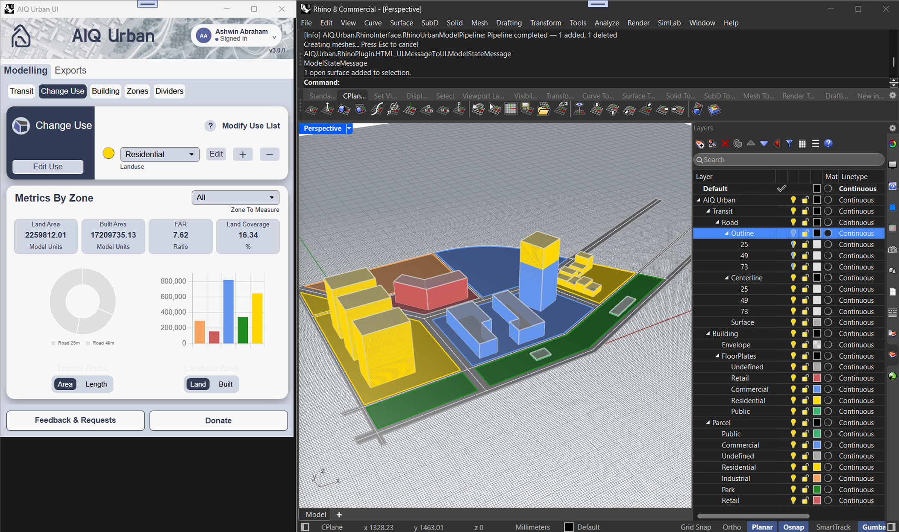
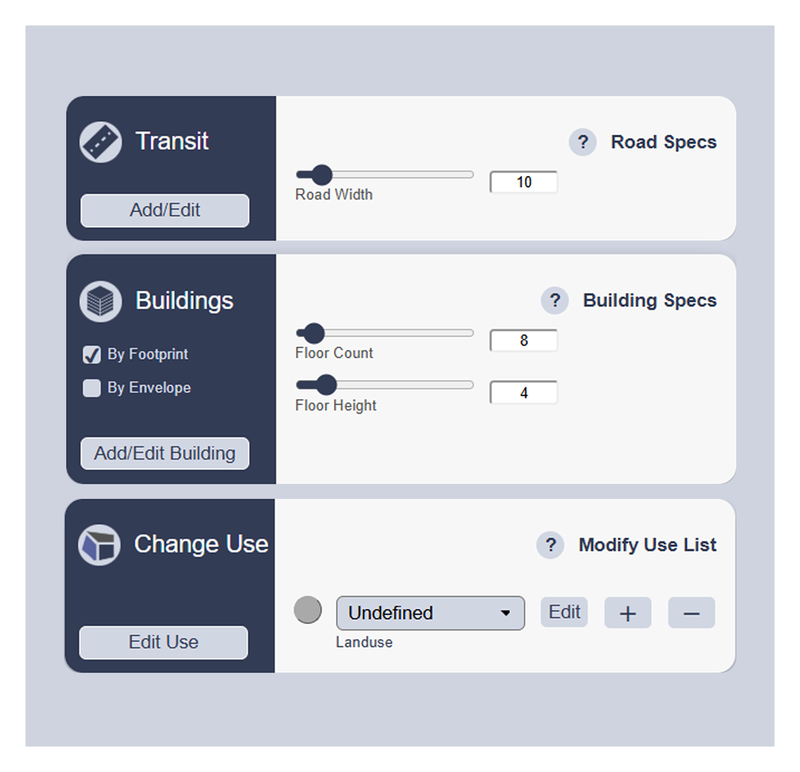
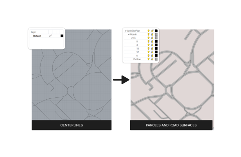

# AIQ Urban

AIQ Urban is a Rhino 8 plug-in for urban design and master planning. It automates routine drafting and updates planning metrics as you edit the model, so you can compare design options in Rhino.

## Download and install

**[Download AIQ Urban from Food4Rhino](https://www.food4rhino.com/en/app/aiqurban)**

Food4Rhino is the official download source. After installation, run `AIQ_Urban` in Rhino to open the plug-in. If Rhino does not recognize that command, run `AIQUrban`, the command registered by the current source code.

## Features

- **Road networks** — Lay out roads, adjust their widths, and track total road length and area.
- **Land use** — Assign and edit zones for housing, commerce, industry, and public space.
- **Buildings** — Create building massing and adjust its parameters as you test different layouts.
- **Live metrics** — Track floor area ratio, built-up area, plot coverage, and the area assigned to each land use.
- **Excel reports** — Export planning metrics and project summaries for review and documentation.

Screenshots from the [AIQ Urban listing on Food4Rhino](https://www.food4rhino.com/en/app/aiqurban).

## Source code

ArchSitePlan contains the C#/.NET 8 source code for AIQ Urban. The [core project](src/AIQ.Urban.Core/) contains the planning model and rules. The [Rhino interface](src/AIQ.Urban.RhinoInterface/) connects the model to Rhino, and the [Rhino plug-in](src/AIQ.Urban.Rhino/) provides the commands and user interface. The [export project](src/AIQ.Exports/) contains the Excel export code.

## License

The repository uses the [PolyForm Strict License 1.0.0](LICENSE).
